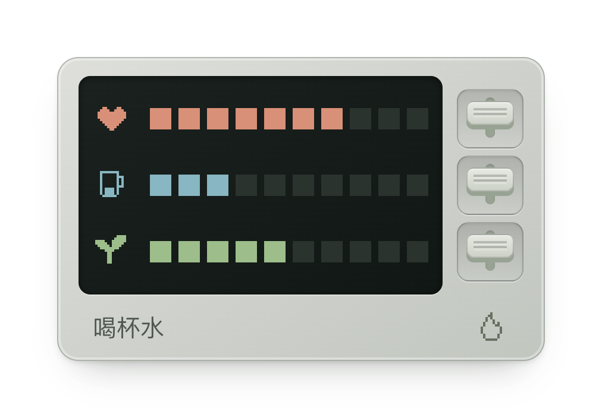

# 1UP

<p align="center">
  
</p>

一个常驻 macOS 菜单栏的健康习惯小工具。用 HP、水分、SAN 三条状态提醒起身、喝水和远眺，休息后自动恢复；只有安静提示，没有通知。

支持 macOS 14 及以上，Apple Silicon 与 Intel。安装时将 `1UP.app` 拖入 Applications；点击菜单栏图标打开面板，右键可设置登录启动、编辑文案或退出。

应用无需账号，不联网，不含分析或遥测。状态与自定义文案仅保存在本机 `~/Library/Application Support/LifeStatus/`。这是习惯提醒工具，进度条不代表真实健康指标。

使用 Xcode Command Line Tools 和 Python 3 构建：

```sh
swift test
swift run LifeStatus
python3 scripts/build.py --unsigned
```

产物位于 `dist/`。`--unsigned` 用于本机开发；对外分发需要 Developer ID Application 证书，并使用 `python3 scripts/build.py --notary-profile YOUR_PROFILE` 签名及公证。凭据存放在本机 Keychain。

默认文案在 `config/`；已安装应用的文案可从右键菜单编辑。正式图标在 `assets/`。

采用 [MIT License](LICENSE)。
